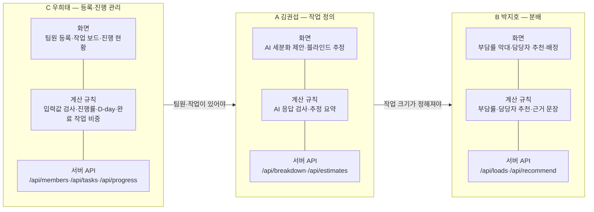

# 역할 분담과 일정

제품이 무엇이고 왜 이렇게 설계했는지는 루트의 [README.md](../README.md)를, 브랜치·커밋 규칙은 [CONTRIBUTING.md](../CONTRIBUTING.md)를 먼저 읽어주세요.

이 문서는 세 명이 서로 기다리지 않고 작업하기 위한 공용 계약입니다.

## 나누는 원칙 — 기능을 셋으로, 각자 화면부터 서버까지

한 사람이 화면만, 다른 사람이 서버 API만 맡는 식으로 나누지 않습니다.

앱의 기능을 셋으로 나누고, 각자 자기 기능에 필요한 화면·계산 규칙·서버 API를 모두 만듭니다. 최종 발표에서도 각자 자기 기능을 직접 시연합니다.



사용 순서는 등록하고(C) → 작업 크기를 정하고(A) → 담당자를 나누고(B) → 진행 상황을 확인하는(C) 흐름입니다.

## 기능 명세

### C 우희태 — 등록·진행 관리

팀원과 작업을 등록하고, 진행 상황을 보여줍니다.

| 구분 | 만드는 것 | 파일 |
|---|---|---|
| 화면 | 팀원 등록·목록·삭제, 작업 보드, 진행률·D-day·완료 작업 비중·주차별 수행률 | `public/js/board.js` |
| 계산 규칙 | 입력값 검사, 진행률, D-day, 완료 작업 비중, 주차별 수행률 | `src/lib/validate.js`·`progress.js` |
| 서버 API | 팀원·작업 등록·수정·삭제, 진행률·주차별 수행률 조회 | `src/routes/members.js`·`tasks.js`·`progress.js`·`weekly.js` |
| 테스트 | 55개 | `test/validate.test.js`·`progress.test.js`·`completed-at.test.js`·`tasks-api.test.js`·`members-api.test.js`·`room-board-api.test.js` |
| 시연 | 팀원·작업 등록 → 입력 오류 안내 → 완료 처리 → 팀원 삭제·담당 해제 → 진행 현황 변화 | |

### A 김권섭 — 작업 정의

큰 작업을 AI로 나누고, 각 작업의 크기를 팀이 함께 정합니다.

| 구분 | 만드는 것 | 파일 |
|---|---|---|
| 화면 | AI 세분화 제안, 블라인드 추정·공개·논의·크기 확정 | `public/js/sizing.js` |
| 계산 규칙 | AI 응답 검사, 추정 공개 조건·중앙값·의견 차이·수정 기록 | `src/lib/breakdown.js`·`estimate.js` |
| 서버 API | 세부 작업 제안, 추정 제출·조회 | `src/routes/breakdown.js`·`estimates.js` |
| LLM 호출 | 서버에서 Gemini 호출 | `src/lib/llm.js` |
| 테스트 | 43개 | `test/breakdown.test.js`·`estimate.test.js`·`llm.test.js` |
| 시연 | 기존 작업 선택 → 세분화 → 추정 제출 → 동시 공개 → 팀이 시간 확정 | |

### B 박지호 — 분배

팀원별 부담률을 계산하고, 새 작업을 누가 맡으면 좋을지 근거와 함께 추천합니다.

| 구분 | 만드는 것 | 파일 |
|---|---|---|
| 화면 | 부담률 막대, 계산 근거, 담당자 추천·배정 | `public/js/load.js` |
| 계산 규칙 | 작업 부담률, 담당자 추천, 제외·동률 규칙, 추천 근거 문장 | `src/lib/load.js`·`explain.js` |
| 서버 API | 부담률 조회, 담당자 추천 | `src/routes/loads.js`·`recommend.js` |
| 테스트 | 26개 | `test/load.test.js`·`explain.test.js`·`recommend-api.test.js` |
| 시연 | 추천 → 예상 부담률·근거 → 담당자 선택·배정 → 막대 변화 | |

### 공용 뼈대

공용 뼈대는 각자의 기능을 연결하는 기반입니다.

| 뼈대 | 담당 | 내용 |
|---|---|---|
| 서버 | B | Express 연결, JSON 저장소, 환경 변수, Docker 실행 설정 |
| 방 서버 | B | 방 규칙·저장소·API·공용 방 코드 검사 |
| 화면 | C | 홈과 기능별 페이지, 공용 API 호출·화면 갱신 |
| 스타일 | A | 공용 스타일, [디자인 가이드](DESIGN.md), [목업](design-mockup.html) |

추천 결과를 설명하는 문장은 분배 기능(B)에 포함합니다. 추천과 근거가 같은 기능 안에 있어야 각자의 화면·규칙·API가 연결됩니다.

## 기능 사이의 경계

기능끼리는 저장된 데이터와 화면의 `data` 이벤트로 연결합니다. 다른 담당자의 함수를 직접 호출하는 경우는 아래에 명시한 공용 검사·공개 처리 예외로 한정합니다.

| 만나는 곳 | 규칙 |
|---|---|
| 저장 | 전환 중인 기존 라우터는 `load()`·`save()`로 기본 데이터를 사용합니다. 전환한 라우터는 `loadRoom(req.roomCode)`·`saveRoom(req.roomCode, db)`를 사용합니다 |
| 작업 크기 | A 화면이 확정 → C의 `PATCH /api/tasks/:id { hours }` 호출 |
| 담당자 | B 화면이 배정 → C의 `PATCH /api/tasks/:id { assigneeId }` 호출 |
| 세부 작업 | A 화면이 고른 제목 → C의 `POST /api/tasks { title, parentId }` 호출 |
| 추정값 | 작업 목록 응답에는 추정 원본·수정 기록을 넣지 않습니다. A의 추정 조회 API만 요약을 반환합니다 |
| 화면 갱신 | 데이터 변경 후 `refresh()` → `data` 이벤트 → 각자 자기 화면 갱신 |
| 상위 작업 | 다른 작업이 `parentId`로 가리키는 작업은 계산·추정·추천 대상에서 제외합니다 |
| 입장 이름 검사 | B의 입장 API는 C의 `validateMember()`를 재사용합니다 |
| 팀원 삭제와 공개 | C는 A의 `revealAfterMemberRemoved()`로 공개 기록을 갱신합니다 |
| 정원 변경과 공개 | B는 등록 인원이 정원과 같을 때 A의 공개 처리 함수로 공개 조건을 재검사합니다 |

### 팀원을 지울 때 추정 공개 처리

팀원이 빠지면 남은 팀원 전원이 제출한 상태가 될 수 있습니다. 공개 조건이 충족되면 삭제 요청 안에서 공개 여부와 첫 버전을 기록합니다.

삭제된 팀원의 추정 원본은 남기되, 현재 팀원 목록을 기준으로 공개 값과 중앙값 계산에서 제외합니다.

```js
import { revealAfterMemberRemoved } from '../lib/estimate.js';

const ids = db.members.map((member) => member.id);
const now = new Date().toISOString();

for (const task of db.tasks) {
  Object.assign(
    task,
    revealAfterMemberRemoved(task, ids, now)   // 입장 코드를 켠 방이면 네 번째 값으로 줄어든 room.size
  );
}

save(db);
```

위 코드는 기존 기본 방 기준의 호출 예시입니다. 방 기능 전환 시에는 방의 정원 조건과 방별 저장 호출을 함께 반영해야 합니다.

함수는 원본 작업을 직접 변경하지 않고 덮어쓸 값을 반환합니다. 관련 테스트는 A의 `test/estimate.test.js`에서 관리합니다.

### 상위 작업은 세지 않습니다

상위 작업은 다른 작업이 `parentId`로 가리키는 작업입니다. 별도 상태 필드를 두지 않고 전체 작업 목록에서 판단합니다.

```js
const parentIds = new Set(
  tasks.map((task) => task.parentId).filter(Boolean)
);

const isParent = (task) => parentIds.has(task.id);
```

| 기능 | 상위 작업을 제외하는 곳 |
|---|---|
| A | 추정·확정 대상 목록 |
| B | 현재 작업량, 추천 대상 목록 |
| C | 진행률, 완료 작업 비중, 주차별 수행률, 진행 현황의 건수·맡은 시간 |

- 작업 보드에는 상위 작업도 표시합니다.
- 세부 작업 카드에는 상위 작업과의 관계를 표시합니다.
- 세부 작업이 없는 작업은 일반 작업으로 계산합니다.
- 재추천에서는 전체 목록으로 부모를 먼저 판별한 뒤 추천 대상 작업을 제외합니다. 반대로 하면 유일한 자식을 뺀 뒤 부모가 일반 작업으로 잘못 계산될 수 있습니다.

## 공용 데이터 형태

```js
// 팀원
{
  id: 'm1',
  name: '김권섭',
  availableHours: 10
}

// 작업
{
  id: 't1',
  title: '발표 자료 제작',
  parentId: null,
  status: 'TODO',
  assigneeId: null,
  dueDate: '2026-12-01',
  hours: null,
  estimates: {
    m1: {
      hours: 3,
      reason: '슬라이드 10장 기준'
    }
  },
  estimatesRevealed: false,
  estimateHistory: [],
  createdAt: '2026-11-10T09:00:00.000Z',
  completedAt: null
}
```

- `availableHours`: 팀원이 입력한 가능한 시간입니다. 현재 화면에서는 이번 주 기준으로 안내합니다.
- `hours`: 팀이 확정한 작업의 예상 시간입니다. 미확정이면 `null`입니다.
- `status`: `TODO`, `DOING`, `DONE` 중 하나입니다.
- `dueDate`: 실제로 존재하는 `YYYY-MM-DD` 날짜 또는 `null`입니다.
- `completedAt`: 완료로 전환한 시각입니다. 완료를 해제하면 `null`입니다.
- `estimates`, `estimateHistory`: 서버에서 관리하고 일반 작업 목록 응답에서는 제외합니다.
- `estimatesRevealed`: 한 번이라도 공개된 작업인지 기록합니다.

데이터 형태와 API 계약을 바꾸는 경우 병합 전에 다른 팀원에게 알립니다.

### 방별 저장 구조와 전환 상태

방 서버 뼈대는 구현됐지만 기존 기능 API와 화면의 방별 전환은 남아 있습니다.

**전체 전환과 통합 검증이 끝날 때까지 `ROOMS_ENABLED`는 0 또는 미설정으로 유지합니다.**

#### 스위치가 꺼져 있고 기존 형식인 경우

```js
{
  members: [],
  tasks: []
}
```

- 조회만으로 파일을 생성하거나 변경하지 않습니다.
- `load()`·`save()`는 기존 형식을 유지합니다.
- 기본 방의 `loadRoom()`·`saveRoom()`도 사용할 수 있습니다.
- 기본 방 코드는 저장 없이 `LEGACY`로 반환합니다.
- `loadRoom('LEGACY')`는 아래와 같은 임시 방 정보를 반환합니다.

```js
{
  name: '기존 프로젝트',
  size: 1,
  demo: false,
  members: [],
  tasks: [],
  createdAt: null
}
```

임시 방의 정원은 `max(등록 인원, 1)`입니다. 방 이름·정원·생성 시각 같은 메타데이터는 기존 형식 파일에 저장하지 않습니다.

#### 스위치를 켜고 기존 파일을 읽는 경우

기존 원본을 같은 폴더의 `db.json.before-rooms-<고유값>.bak`으로 백업한 후 방별 구조로 이전합니다.

```js
{
  schemaVersion: 1,
  defaultRoom: 'LEGACY',
  rooms: {
    LEGACY: {
      name: '기존 프로젝트',
      size: 3,
      demo: false,
      members: [],
      tasks: [],
      createdAt: '2026-11-21T00:00:00.000Z'
    }
  }
}
```

- 기존 팀원·작업의 ID, 추정값, 수정 기록, 완료 시각 등 기존 필드를 보존합니다.
- 기존 파일이 없으면 새 구조를 생성하며, 백업할 원본이 없으므로 백업 파일은 만들지 않습니다.
- 이미 이전된 파일은 다시 이전하거나 백업하지 않습니다.
- 잘못된 JSON이나 저장 구조는 덮어쓰지 않고 오류로 처리합니다.

#### 이미 이전된 파일에서 스위치를 끈 경우

방별 구조를 그대로 읽고 사용합니다. 자동으로 옛 형식으로 되돌리거나 다른 방을 삭제하지 않습니다.

따라서 이전 코드로 복귀할 때는 스위치를 끄는 것만으로 충분하지 않으며, 해당 코드가 읽을 수 있는 백업을 별도로 복원해야 합니다.

#### 기본 방 정원 보정

기존 팀원 등록 API를 사용하는 전환 기간에는 기본 방 정원이 등록 인원보다 작아질 수 있습니다.

방별 구조의 기본 방은 조회 결과에서 정원을 등록 인원 이상으로 보정하며, 다음 저장 시 보정값을 반영합니다. 조회만으로 보정값을 파일에 다시 쓰지는 않습니다.

일반 방의 정원을 자동으로 늘리지는 않습니다. 일반 방의 입장은 정원 초과를 거절합니다.

#### 저장소 함수

| 함수 | 동작 |
|---|---|
| `load()` | 기본 데이터의 `{ members, tasks }` 반환 |
| `save(db)` | 기본 데이터 저장. 기존 형식이면 그대로 유지하고, 방별 형식이면 기본 방만 변경 |
| `getDefaultRoomCode()` | 기존 형식이면 `LEGACY`, 방별 형식이면 저장된 기본 방 코드 반환 |
| `loadRoom(code)` | 방 정보·팀원·작업 반환. 잘못되거나 없는 코드는 `null` |
| `saveRoom(code, room)` | 기존 방 저장. 방별 형식에서는 생략된 방 정보와 다른 방을 보존 |
| `createRoom({ name, size })` | 켜진 상태에서만 새 방 생성 후 `{ code, ...room }` 반환 |
| `createStore(filePath, { enabled })` | 테스트용 파일 경로와 스위치를 주입한 독립 저장소 생성 |

저장 위치는 `DATA_DIR`을 따릅니다. 미설정·빈 값이면 프로젝트의 `data/`를 사용합니다.

#### 방 입장 규칙

- 코드는 영문 대문자·숫자 6자리이며 `0`, `O`, `1`, `I`를 제외합니다.
- 입력 코드의 앞뒤 공백을 제거하고 소문자를 대문자로 정리합니다.
- 방 이름은 공백 제거 후 1~50자입니다.
- 정원은 1 이상의 안전한 정수입니다.
- 최초 입장은 이름만 받습니다.
- 팀원 ID는 서버가 생성하고 가능한 시간은 0으로 시작합니다.
- 같은 방의 중복 이름과 정원 초과 입장은 거절합니다.
- 서로 다른 방에서는 같은 이름을 사용할 수 있습니다.
- 기존 팀원 재입장 화면과 브라우저 저장 처리는 후속 작업입니다.
- 방 코드는 개인 신원이나 방장 권한을 인증하는 수단이 아닙니다.

#### 방 코드 검사와 활성화

- `ROOMS_ENABLED=1`일 때만 방 API가 동작합니다.
- 꺼져 있으면 방 생성·조회·입장·정원 수정 API는 404를 반환합니다.
- `GET /api/config`는 스위치와 관계없이 호출할 수 있습니다.
- 설정 조회와 방 생성·조회·입장은 공용 방 코드 검사보다 먼저 처리합니다.
- 정원 수정은 URL의 방 코드와 `X-Room-Code` 헤더가 일치해야 합니다.
- 켜진 상태에서 기존 기능 API는 `X-Room-Code`를 검사하고 `req.roomCode`를 전달받습니다.
- 헤더 누락·형식 오류는 400, 존재하지 않는 방은 404입니다.
- 꺼진 상태에서는 헤더를 무시하고 기본 방 코드를 전달합니다.

#### 켜는 순서 (#60 리뷰 합의, 11/23)

1. A — `estimates.js` 방 단위 전환 + 추정 공개에 정원(`room.size`) 전달
2. C — 공용 머리말 방 정보 · 등록 폼 정리 — 머리말 `팀명 · 내 이름 · 나가기`, 켜지면 팀원 등록 폼 숨김 · `POST /api/members` 400, 내가 지워졌으면 `enter.html?code=` 로 다시 고르기
3. B — 통합 검증 뒤 `ROOMS_ENABLED=1`. 11/27 까지 목표, 그 전까지 `0`

- 화면은 스위치를 `GET /api/config` 의 `roomsEnabled` 로 판별합니다. 다른 경로의 404 문장으로 짐작하지 않습니다.
- 첫 화면은 홈입니다. 입장 코드가 켜져 있고 저장된 방이 없으면 입장 화면으로 이동합니다(11/23 결정).
- 체험 방 버튼은 API 를 만드는 동안 `준비 중`, 11/28 동결까지 API 가 없으면 숨깁니다(11/23 결정).
- 입장 화면은 "처음 참여"(새 이름, 같은 이름 거절)와 "기존 팀원"(이름 고르기, 본인 확인 없음)을 나눠 둡니다.
- 방 코드 오류는 장기적으로 문장 대신 오류 코드로 판별합니다(방향 합의, 시점은 미정).

공용 미들웨어가 데이터를 자동으로 분리하지는 않습니다. 각 라우터의 저장소 호출을 방별 함수로 전환해야 합니다.

#### 체험 방 처음 상태 — `seed/demo.json` (11/25 희태, A 의 틀 작업을 넘겨받음)

체험 방 API(A)가 누를 때마다 새 방을 만들 때 쓰는 처음 상태입니다. 세 화면 시연에 필요한 것이 다 들어 있습니다.

- 날짜는 상대값입니다 — `dueInDays`(음수면 마감 지남) · `createdDaysAgo` · `completedDaysAgo` · `history[].atDaysAgo`
- `demoRoom(seed, now)`(`src/lib/demo.js`)가 실제 날짜로 바꾼 방 `{ name, size, demo: true, createdAt, members, tasks }` 를 돌려줍니다. 마감일은 한국 날짜, 원본은 바꾸지 않습니다
- `_설명` · `_역할` 은 사람이 읽는 메모라 바꾼 결과에 남지 않습니다
- 팀원 이름은 실제 사람이 아닌 예시입니다

| 시연 | 들어 있는 것 |
|---|---|
| A 작업 정의 | 큰 작업 `기말 발표 준비` 와 세부 4개, 두 명만 낸 `리허설`(세 번째로 내면 공개), 의견 차이가 커서 ver 2 로 조율한 `슬라이드 제작`, 아무도 안 낸 작업 |
| B 분배 | 크기 확정 · 담당 미정 `대본 작성` · `시연 영상 촬영`, 부담률 0% · 63% · 125%(과부하) |
| C 등록 · 진행 | 할 일 · 진행 중 · 완료 다 있음, 마감 지난 작업, 지난주 · 이번 주 수행률 |

`test/demo-seed.test.js` 가 위 조건을 실제 계산 함수(`estimateSummary` · `currentHours` · `weeklyRates` 등)로 확인합니다. 데이터를 바꾸면 이 테스트를 돌려 주세요.

#### 각 담당자의 후속 작업

| 담당 | 후속 작업 |
|---|---|
| A | 추정·세분화 라우터 전환, 정원을 반영한 최초 공개 조건, 입장 화면·체험 방 |
| B | 부담률·추천 라우터 전환, 전체 전환 후 활성화·통합 검증 |
| C | ~~팀원·작업·진행률·주차별 라우터 전환~~ (완료 — `loadRoom(req.roomCode)` · `saveRoom(req.roomCode, room)`, 팀원 삭제 시 정원 1 감소), 공용 화면의 방 코드 전달·참여 정보 관리 |

정원 변경 API는 등록 인원이 새 정원과 같을 때 공개 조건을 재검사하고, 필요한 공개 기록을 저장합니다.

추정 제출·조회는 방 단위로 전환되었고, 입장 코드가 켜져 있으면 정원이 차기 전에는 최초 공개되지 않습니다(`createEstimatesRouter`, 11/23). 꺼져 있으면 정원을 보지 않고 등록된 전원 기준입니다 — 방별 형식으로 옮긴 기본 방의 정원이 등록 인원보다 커도 공개가 막히지 않습니다(11/24). 기존 테스트용 저장소 주입 방식도 각 라우터 전환에 맞춰 수정합니다.

## API 형식

오류 응답은 다음 형식입니다.

```json
{
  "error": "한국어 안내 문장"
}
```

| 상태 | 의미 |
|---|---|
| 400 | 잘못된 입력·JSON·방 코드 |
| 404 | 존재하지 않는 데이터·경로 또는 비활성화된 방 API |
| 413 | 요청 본문 10KB 초과 |
| 500 | 서버 내부 오류 |

상세 오류는 서버 로그에만 남깁니다. 응답에는 PC 경로나 오류 스택을 넣지 않습니다.

| 담당 | 메서드·경로 | 요청 본문 | 응답 |
|---|---|---|---|
| 공용 | `GET /api/config` | — | `{ roomsEnabled: boolean }` |
| B | `POST /api/rooms` | `{ name, size }` | `{ code, name, size }`·201 |
| B | `GET /api/rooms/:code` | — | `{ code, name, size, memberCount }` |
| B | `POST /api/rooms/:code/join` | `{ name }` | `Member`·201 |
| B | `PATCH /api/rooms/:code` | `{ size }` | `{ code, name, size, memberCount }` |
| C | `GET /api/members` | — | `Member[]` |
| C | `POST /api/members` | `{ name, availableHours }` | `Member` (201) — 같은 이름이면 400 |
| C | `PATCH /api/members/:id` | `{ name?, availableHours? }` | `Member` — 다른 팀원과 같은 이름이면 400 |
| C | `DELETE /api/members/:id` | — | `{ deleted, unassigned: [taskId, …] }` — 맡은 작업은 담당 미정, 추정은 보존하되 현재 계산에서 제외, 공개 조건 충족 시 공개 기록. 없으면 404 |
| C | `GET /api/tasks` | — | `Task[]` — `estimates`·`estimateHistory` 제외 |
| C | `POST /api/tasks` | `{ title, dueDate?, parentId? }` | `Task` (201) |
| C | `PATCH /api/tasks/:id` | `{ status?, assigneeId?, hours?, dueDate?, title? }` | `Task` — 추정 공개 전 숫자 `hours`는 400, `null`은 허용 |
| C | `DELETE /api/tasks/:id` | — | `{ deleted: [id, …] }` — 모든 하위 작업 포함, 없으면 404 |
| C | `GET /api/progress` | — | 진행 현황 요약 |
| C | `GET /api/weekly` | — | `{ weeks: [...] }` |
| A | `POST /api/breakdown` | `{ title }` | `{ subtasks: string[], source: 'ai' \| 'fallback' }` |
| A | `POST /api/tasks/:id/estimates` | `{ memberId, hours, reason? }` | `{ taskId, estimate }` |
| A | `GET /api/estimates` | — | `{ [taskId]: estimate }` |
| B | `GET /api/loads` | — | `{ members: [...] }` |
| B | `POST /api/recommend` | `{ taskId }` 또는 `{ hours }` | 추천 결과 |

### 주요 입력·수정 규칙

- 팀원 등록·이름 수정에서 다른 팀원과 같은 이름이면 400입니다.
- 이름의 앞뒤 공백은 제거해서 비교합니다.
- 방 입장은 가능한 시간을 0으로 시작합니다.
- 정원은 현재 등록 인원보다 작게 변경할 수 없습니다.
- 작업 목록 응답은 `estimates`·`estimateHistory`를 제외합니다.
- 추정 공개 전에 작업의 `hours`를 숫자로 변경하면 400입니다.
- `hours: null`로 되돌리는 것은 허용합니다.
- 상위 작업 삭제 시 모든 하위 작업을 함께 삭제합니다.
- 존재하지 않는 작업 삭제는 404입니다.
- 기존 `POST /api/members`는 전환 기간에 유지하고, 입장 화면 연결과 함께 제거합니다.

### 진행률 응답

```js
{
  progress: 40,       // 전체 진행률 %
  doneHoursTotal: 12, // 완료된 작업의 확정 예상 시간 합
  members: [
    {
      memberId: 'm1',
      name: '김권섭',
      doneShare: 50,
      doneHours: 6
    }
  ],
  // 담당자 없는 완료 작업의 몫. 0시간이면 화면에 표시하지 않음
  unassigned: {
    doneShare: 20,
    doneHours: 2
  }
}
```

### 추정 요약 응답

공개 전에는 값·근거·중앙값을 보내지 않습니다.

```js
{
  revealed: false,
  submittedIds: ['m1']
}
```

공개 후에는 값·근거·중앙값·수정 기록을 보냅니다.

```js
{
  revealed: true,
  submittedIds: ['m1', 'm2', 'm3'],
  values: {
    m1: 3,
    m2: 4,
    m3: 8
  },
  median: 4,
  wideSpread: true,
  reasons: {
    m1: '슬라이드 10장 기준',
    m3: '디자인까지 포함'
  },
  history: [
    {
      version: 1,
      by: null,
      at: '2026-11-21T00:00:00.000Z',
      values: {
        m1: 3,
        m2: 4,
        m3: 8
      },
      reasons: {
        m1: '슬라이드 10장 기준',
        m3: '디자인까지 포함'
      },
      median: 4
    }
  ]
}
```

- **정원(입장 코드를 켠 방):** 등록 인원이 방 정원에 닿기 전에는, 등록된 사람이 모두 내도 공개하지 않습니다. 나중에 들어온 사람이 이미 공개된 값을 보고 추정하는 것을 막기 위해서입니다. `estimateSummary(estimates, memberIds, wasRevealed, size)` 의 네 번째 값으로 `room.size` 를 넘기고, 입장 코드가 꺼져 있으면 넘기지 않습니다(지금과 같음).
- 한 번 공개된 작업은 팀원이 늘어도 다시 가리지 않습니다.
- 공개 후 제출·수정한 값은 요약에 반영합니다.
- 공개된 값이나 근거가 변경되면 다음 버전을 남깁니다.
- 공개 전 재제출은 이전 입력을 교체합니다.

### 부담률 응답

```js
{
  members: [
    {
      memberId: 'm1',
      name: '김권섭',
      currentHours: 6,
      availableHours: 10,
      load: 60,
      overloaded: false
    }
  ]
}
```

- `currentHours`: 상위 작업을 제외한, 맡은 미완료 작업의 확정 예상 시간 합계입니다.
- `availableHours`: 팀원이 입력한 가능한 시간입니다.
- 가능한 시간이 0이면 `load`는 `null`입니다.

### 추천 응답

```js
{
  recommendedId: 'm2',
  candidates: [
    {
      memberId: 'm2',
      name: '박지호',
      currentLoad: 30,
      projectedLoad: 50
    },
    {
      memberId: 'm1',
      name: '김권섭',
      currentLoad: 60,
      projectedLoad: 100
    }
  ],
  excluded: [
    {
      memberId: 'm3',
      name: '우희태',
      reason: 'NO_AVAILABLE_TIME'
    }
  ],
  explanation: '박지호 님이 맡으면 부담률이 30% → 50%로 가장 낮습니다.'
}
```

- 후보가 없으면 `recommendedId`는 `null`입니다.
- 순위는 반올림 전 예상 부담률 → 반올림 전 현재 부담률 → 팀원 등록 순서로 정합니다.
- 화면 표시용 부담률은 정수로 반올림합니다.
- 완료 작업의 추천 요청은 400입니다.
- 상위 작업 ID의 추천 요청은 400입니다.
- 재추천에서는 대상 작업을 현재 작업량에서 제외한 뒤 배정 후 부담률을 계산합니다.
- 추천 요청은 작업이나 담당자를 변경하지 않습니다.

## 화면을 나눠 쓰는 법

한 화면에 모든 기능을 넣지 않고 홈에서 기능별 화면으로 이동합니다.

각자 자기 페이지와 자기 자바스크립트 파일을 수정합니다. 모양은 [디자인 가이드](DESIGN.md)와 [목업](design-mockup.html)을 따릅니다.

| 페이지 | 자리 | 담당 파일 |
|---|---|---|
| `index.html` | 첫 화면(인트로) | A·`public/intro.css` |
| `home.html` | 홈 카드·`#progress` | C·`public/js/board.js` |
| `board.html` | `#task-form`·`#tasks`·`#members`·`#progress` | C·`public/js/board.js` |
| `sizing.html` | `#breakdown`·`#sizing` | A·`public/js/sizing.js` |
| `load.html` | `#load`·`#recommend` | B·`public/js/load.js` |

머리말 메뉴를 바꿀 때는 네 페이지를 함께 확인합니다.

```js
import { api, refresh } from './api.js';

document.addEventListener('data', async (event) => {
  const { members, tasks } = event.detail;

  // 각자 필요한 조회를 수행하고 자기 화면을 갱신한다.
});
```

데이터를 바꾼 뒤에는 `refresh()`를 호출합니다. 실시간 통신은 사용하지 않습니다.

## 전원이 지키는 원칙 넷

**1. 숫자는 AI를 거치지 않습니다.**

부담률·추천·진행률·완료 작업 비중은 서버의 계산 함수로 구합니다. LLM은 세부 작업 제목만 제안합니다.

**2. AI가 실패해도 나머지는 동작합니다.**

서버의 LLM 호출이 실패하면 세분화 API는 빈 제안과 `fallback`을 반환합니다. 브라우저에서 서버에 연결하지 못한 경우에는 연결 오류를 안내합니다.

**3. 추천은 참고 자료이고 결정은 사람이 합니다.**

서버는 담당자를 자동 지정하지 않습니다. 작업 크기도 중앙값을 참고로 제시하고 팀이 확정합니다.

**4. 회원가입과 실제 개인정보 수집을 하지 않습니다.**

학번·연락처·이메일·비밀번호를 받지 않습니다. 참여 표시용 이름과 가능한 시간을 사용하며, 방 코드는 개인 신원 인증 수단으로 설명하지 않습니다.

## 일정

최종 마감은 12월 3일, 기능 동결은 11월 28일을 기준으로 진행합니다.

구체적인 역할별 일정은 각 지침서와 [상태 문서](https://github.com/Heetaeeee/hallae-mallae/blob/kwonseop/status-check/team/STATUS.md)를 확인합니다.

### 중간발표 전 기본 흐름

팀원·작업 등록 → 추정 제출·공개·확정 → 추천·배정 → 완료 처리 → 부담률·진행률 갱신.

| 담당 | 기본 기능 |
|---|---|
| C | 팀원·작업 등록, 입력 검사, 진행률 |
| A | 추정·공개·확정, AI 세분화와 실패 시 대체 입력 |
| B | 저장소, 부담률, 담당자 추천·배정과 근거 |

### 중간발표 이후

| 담당 | 보완 |
|---|---|
| C | 진행 현황, 작업 삭제, 입력 보호, 공용 화면 오류와 갱신 |
| A | 세분화 사용 흐름, 추정 화면, LLM 실패 처리, 방 정원 반영 |
| B | 상위 작업 계산 제외, Docker, 방 저장소·서버 뼈대, 배포 |
| 전원 | 공용 계약 확인, PR 검토, 다른 기기에서 통합 사용 점검 |

### 최종 확인

- [ ] 전체 테스트 통과
- [ ] 각자 화면·계산 규칙·API를 설명하고 시연할 수 있음
- [ ] 배포 주소에서 핵심 흐름 사용 가능
- [ ] 서버 재시작·컨테이너 교체 후 데이터 유지
- [ ] LLM 키가 없어도 핵심 기능 사용 가능
- [ ] 방 기능 활성화 시 서로 다른 방의 데이터가 섞이지 않음
- [ ] 정원 미충족·미제출 상태에서는 최초 추정값이 공개되지 않음
- [ ] 잘못된 입력에 한국어 안내 표시
- [ ] 공개 전 추정값·근거가 API 응답에 포함되지 않음
- [ ] 사용자 입력은 HTML로 실행하지 않고 글자로 표시
- [ ] 휴대폰 화면과 키보드 조작 점검
- [ ] 배포 데이터 백업·복원 절차 확인
- [ ] 문서와 실제 기능·API·실행 방법 일치
- [ ] 시연용 데이터를 준비하고 리허설 완료

## 추가 구현

주차별 수행률은 이미 구현된 기능입니다. 지난주 AI 요약은 추가 구현 후보이며 이번 방 서버 뼈대에 포함하지 않습니다.

| 항목 | 주차별 수행률 | 지난주 AI 요약 |
|---|---|---|
| 담당 | C | A |
| 화면 | 주별 막대·완료 건수 | 요약 문장·완료 건수 |
| 계산 | `weeklyRates(tasks, today)` | 응답 검사·고정 문구 대체 |
| API | `GET /api/weekly` | `POST /api/weekly/summary`·계획 |

```js
// 주차별 수행률
{
  weeks: [
    {
      weekStart: '2026-11-09',
      rate: 60,
      done: 3,
      total: 5
    }
  ]
}

// 지난주 요약의 계획 응답
{
  text: '발표 자료와 대본을 마무리했습니다.',
  count: 3,
  source: 'ai'
}
```

| 규칙 | 내용 |
|---|---|
| 주의 기준 | 월요일부터 일요일까지 |
| 수행률 | 그 주 마감 작업 중 현재 완료 상태인 작업의 비율 |
| 마감일 없음 | 주차별 수행률에서 제외 |
| 마감 작업 0건 | 해당 주를 목록에서 제외 |
| 지난주 완료 작업 | `completedAt`이 지난주 범위인 작업 |
| 요약 검사 계획 | 공백 제거 후 1~120자, 최대 3줄 |
| 실패 시 계획 | 완료 작업 제목으로 고정 문구 생성 |
| 완료 작업 0건 | LLM을 호출하지 않고 안내 |

수행률과 완료 건수는 서버가 계산합니다. AI에는 작업 제목만 보내고, AI가 계산 결과를 결정하지 않도록 합니다.

## 파일 소유

| 기능 | 파일 |
|---|---|
| C 등록·진행 | `src/lib/validate.js`·`progress.js`<br/>`src/routes/members.js`·`tasks.js`·`progress.js`·`weekly.js`<br/>`public/js/board.js` |
| A 작업 정의 | `src/lib/breakdown.js`·`estimate.js`·`llm.js`<br/>`src/routes/breakdown.js`·`estimates.js`<br/>`public/js/sizing.js` |
| B 분배 | `src/lib/load.js`·`explain.js`<br/>`src/routes/loads.js`·`recommend.js`<br/>`public/js/load.js` |
| 서버 뼈대·배포 B | `package.json`·`server.js`·`src/app.js`·`src/lib/store.js`·`.env.example`·`Dockerfile`·`.dockerignore` |
| 방 서버 뼈대 B | `src/lib/room.js`·`src/routes/rooms.js`·`src/middleware/room-context.js` |
| 화면 뼈대 C | `public/home.html`·`board.html`·`sizing.html`·`load.html`·`public/js/api.js` |
| 공용 스타일·첫 화면 A | `public/style.css`·`public/index.html`·`public/intro.css`·`team/DESIGN.md`·`team/design-mockup.html` |

각 기능의 테스트는 해당 기능 담당자가 관리합니다.

다른 담당자의 파일을 수정할 때는 먼저 알리고 커밋을 따로 작성합니다.

## 테스트

계산·입력 검사 순수 함수와 저장소·API·공용 미들웨어를 Node 내장 테스트 러너로 검증합니다.

저장소·API 테스트는 임시 폴더와 별도 서버를 사용하며 실제 데이터를 변경하지 않습니다. 화면은 브라우저에서 별도로 확인합니다.

| 구분 | 개수 |
|---|---:|
| A 기능 | 48 |
| B 분배 기능 | 26 |
| C 기능 | 55 |
| 방 규칙·변환 | 12 |
| 저장소 | 11 |
| 방 API | 18 |
| 공용 방 코드 검사 | 7 |
| B 방별 부담률·추천 API 통합 | 6 |
| 체험 방 처음 상태 | 8 |
| 전체 | 191 |

방 서버 뼈대 테스트 48개, 기존 기능 테스트 129개(A 추정 API 방 단위 5개 포함), B 방별 부담률·추천 API 통합 테스트 6개, 체험 방 처음 상태 테스트 8개를 합쳐 전체 191개입니다.

테스트를 먼저 작성하고 실패를 확인한 뒤 구현합니다. 기능 추가와 병합에 따라 테스트 수가 달라지면 관련 문서도 갱신합니다.
